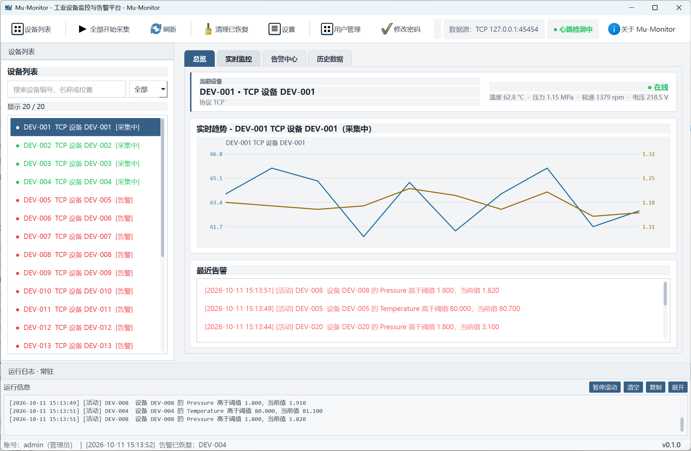
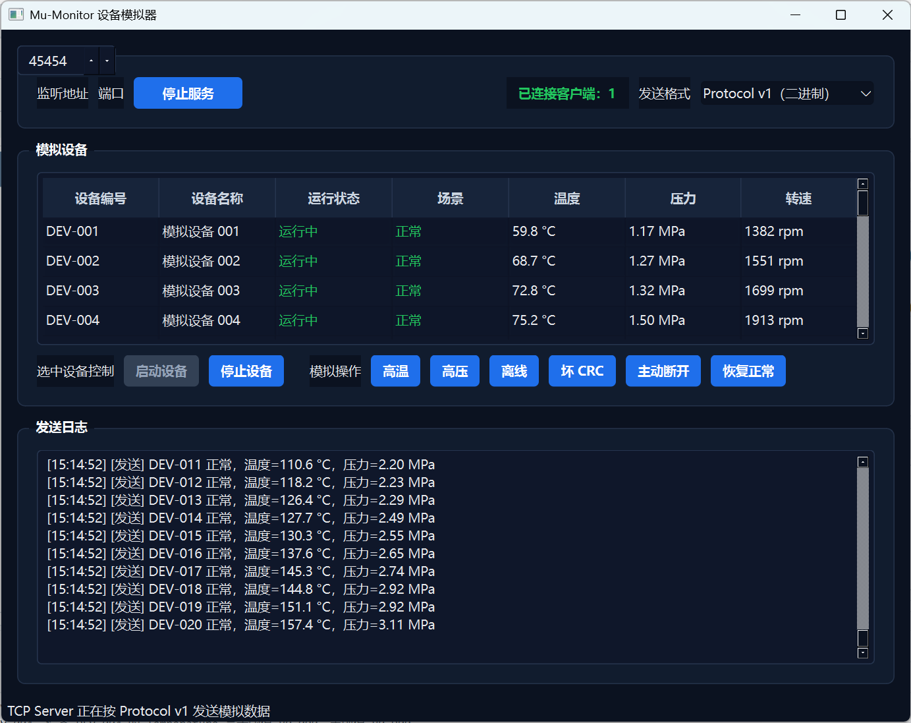

# Mu-Monitor

Windows 单机工业设备监控与告警上位机，基于 C++17 和 Qt 6 Widgets。

支持 TCP 自定义协议、设备模拟、实时监控、SQLite 历史存储、告警生命周期、用户权限和 Excel 导出。

## Screenshots

监控主界面：



设备模拟器（20 台设备独立启停、故障注入与主动断开）：



## Features

- Qt Widgets 桌面界面，支持总览、实时监控、告警中心、历史数据和系统设置
- 内置模拟数据源和独立 TCP 设备模拟器
- Protocol v1 二进制协议、CRC16、粘包和拆包处理
- TCP 超时、坏帧隔离、断线检测和自动重连
- 20 台可独立启动、停止和故障注入的模拟设备
- 高温、高压、离线、坏 CRC 和主动断开场景
- SQLite 历史数据、事务迁移、迁移前备份和旧数据库兼容
- 异步数据库线程、有界任务队列和批量写入
- 告警触发、确认、恢复和状态同步
- 用户、角色、权限、审计日志和密码安全存储
- 历史数据 Excel 导出
- QtTest、CTest 和自动部署脚本

## Architecture

```text
DeviceSimulator / TCP Device
            |
            v
   TcpDeviceDataSourceAdapter
            |
            v
    MonitoringService -----> AlarmEngine
            |
            v
 SqliteTelemetryRepository
            |
            v
          SQLite
            |
            v
      AppController
            |
            v
        MainWindow
```

主要设计约束：

- UI 不直接访问 Socket 或数据库
- 网络、数据库和 Excel 导出不阻塞 GUI 线程
- 数据源通过 `IDeviceDataSource` 与业务层解耦
- 数据库连接只在数据库工作线程中使用

## Requirements

- Windows 10/11 x64
- Qt 6.8.3 LTS，MinGW 13.1.0 64-bit
- CMake 3.30.5
- Ninja 1.12.1
- Qt Creator 14.x 或其他兼容版本
- Git

默认工具路径：

```text
D:\Qt\6.8.3\mingw_64
D:\Qt\Tools\mingw1310_64
D:\Qt\Tools\CMake_64
D:\Qt\Tools\Ninja
```

如果安装位置不同，修改以下脚本中的路径：

```text
scripts/check.ps1
scripts/build_and_deploy.ps1
```

## Build

```powershell
git clone https://github.com/tianwen42/Mu-Monitor.git
cd Mu-Monitor

.\scripts\check.ps1 -Configuration Debug -Clean
.\scripts\check.ps1 -Configuration Release -Clean
```

测试通过标准：

```text
100% tests passed, 0 tests failed out of 19
```

## Package

```powershell
.\scripts\build_and_deploy.ps1
```

脚本会编译 Release 版本、刷新 Qt 运行库、构建两个可执行文件，并保留 `dist/data`。

发布目录：

```text
dist/
  Mu-Monitor.exe
  DeviceSimulator.exe
  Qt6Core.dll
  Qt6Gui.dll
  Qt6Widgets.dll
  Qt6Network.dll
  Qt6Sql.dll
  platforms/
  sqldrivers/
  portable.flag
  data/
```

## Run

```powershell
.\dist\DeviceSimulator.exe
.\dist\Mu-Monitor.exe
```

默认管理员：

```text
用户名：admin
密码：123456
```

首次使用后应立即修改默认密码。

## DeviceSimulator

模拟器默认监听 `127.0.0.1:45454`，发送格式选择 `Protocol v1`。

选中设备后可独立执行：

```text
启动设备
停止设备
高温
高压
离线
坏 CRC
主动断开
恢复正常
```

主程序切换到 TCP 数据源：

1. 打开“设置 -> 连接”。
2. 数据源类型选择“TCP 设备”。
3. 填写 `127.0.0.1:45454` 并保存。
4. 从系统托盘完全退出主程序后重新启动。

主程序默认使用内置模拟数据源，此时不需要启动 `DeviceSimulator.exe`。

## Data

数据目录解析优先级：

```text
--data-dir
MU_MONITOR_DATA_DIR
portable.flag
QStandardPaths::AppLocalDataLocation
```

便携模式目录：

```text
<应用目录>\data\
  database\
    mu-monitor.db
    backups\
  logs\
  exports\
  runtime\
  config\
```

数据库行为：

- 目标数据库存在时直接接入
- 目标数据库不存在时，校验并复制旧数据库
- 迁移前创建带时间戳的备份
- 损坏数据库不会被自动覆盖或删除
- 默认部署不会清理 `dist/data`

需要重置便携数据时执行：

```powershell
.\scripts\build_and_deploy.ps1 -CleanData
```

## Tests

```powershell
.\scripts\check.ps1 -Configuration Debug -Clean
.\scripts\check.ps1 -Configuration Release -Clean
```

也可以直接运行 CTest：

```powershell
ctest --test-dir build\check-release --output-on-failure
```

测试覆盖协议、TCP、设备模拟器、SQLite、异步仓库、用户权限、告警状态机、应用层和界面响应式布局。

## Project Layout

```text
src/
  alarm/       告警规则、事件和状态机
  app/         应用协调层和业务服务
  auth/        认证、用户、角色和审计
  config/      应用和数据源配置
  core/        领域模型和状态定义
  database/    SQLite、Repository 和数据库线程
  network/     TCP 数据源和协议映射
  protocol/    Protocol v1、CRC16 和帧编解码
  ui/          窗口、对话框和界面模型
  utils/       时间和 Excel 工具

tests/         QtTest 自动测试
tools/         独立 DeviceSimulator
scripts/       构建、测试和部署脚本
third_party/   第三方依赖
docs/          架构、协议和数据库文档
```

## Troubleshooting

- 主程序没有数据：确认数据源类型、主机、端口以及模拟器连接数
- 修改设置未生效：从托盘菜单完全退出并重启程序
- 提示缺少 Qt DLL：使用完整 `dist` 目录或重新执行部署脚本
- 数据库初始化失败：检查目录写权限、文件占用和备份目录

## Documentation

- `docs/architecture.md`：架构说明
- `docs/protocol.md`：Protocol v1 协议
- `docs/DATABASE_DESIGN.md`：数据库设计
- `docs/TODOLIST.md`：后续路线

## License

MIT License，详见 `LICENSE`。